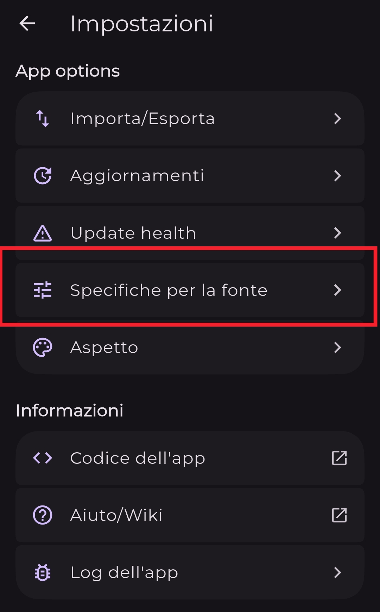

# Installazione e configurazione iniziale

1. Scarica e installa Obtainium aprendo il file scaricato

2. Aprire Obtanium e andare nelle Impostazioni
3. Cliccare su "Specifiche per la fonte"
4. Incollare il numero univoco che ti ho inviato sul campo "GitHub Personal Access Token"

Immagini di esempio

        

# Aggiunta delle app

Cliccare su ognuno dei seguenti pulsanti per aggiungere le app di cui si vuole ricevere gli aggiornamenti.
NB: MicroG-RE è obbligatorio.

### MicroG-RE (Obbligatorio)
Clicca obbligatoriamente sul pulsante per ottenere MicroG-RE, requisito fondamentale per il funzionamento di YouTube e YouTube Music.

[](https://apps.obtainium.imranr.dev/redirect?r=obtainium://app/%7B%0A%20%20%20%20%22id%22%3A%20%22app.revanced.android.gms%22%2C%0A%20%20%20%20%22url%22%3A%20%22https%3A%2F%2Fgithub.com%2FMorpheApp%2FMicroG-RE%22%2C%0A%20%20%20%20%22author%22%3A%20%22MorpheApp%22%2C%0A%20%20%20%20%22name%22%3A%20%22MicroG%20RE%22%2C%0A%20%20%20%20%22additionalSettings%22%3A%20%22%7B%5C%22includePrereleases%5C%22%3Afalse%2C%5C%22includeDrafts%5C%22%3Afalse%2C%5C%22fallbackToOlderReleases%5C%22%3Atrue%2C%5C%22sortMethodChoice%5C%22%3A%5C%22date%5C%22%2C%5C%22versionDetection%5C%22%3Atrue%2C%5C%22apkFilterRegEx%5C%22%3A%5C%22%5Emicrog-%5C%5C%5C%5Cd%2B%5C%5C%5C%5C.%5C%5C%5C%5Cd%2B%5C%5C%5C%5C.%5C%5C%5C%5Cd%2B-icon-arm64-v8a%5C%5C%5C%5C.apk%24%5C%22%2C%5C%22autoApkFilterByArch%5C%22%3Atrue%7D%22%0A%7D)

### Youtube Music
Clicca sul pulsante per ottenere YouTube Music

[](https://apps.obtainium.imranr.dev/redirect?r=obtainium://app/%7B%0A%20%20%20%20%22id%22%3A%20%22app.morphe.android.apps.youtube.music%22%2C%0A%20%20%20%20%22url%22%3A%20%22https%3A%2F%2Fgithub.com%2Frichiemeggio%2Fmorphe%22%2C%0A%20%20%20%20%22author%22%3A%20%22richiemeggio%22%2C%0A%20%20%20%20%22name%22%3A%20%22YT%20Music%22%2C%0A%20%20%20%20%22additionalSettings%22%3A%20%22%7B%5C%22includePrereleases%5C%22%3Afalse%2C%5C%22includeDrafts%5C%22%3Afalse%2C%5C%22fallbackToOlderReleases%5C%22%3Atrue%2C%5C%22sortMethodChoice%5C%22%3A%5C%22date%5C%22%2C%5C%22releaseDateAsVersion%5C%22%3Atrue%2C%5C%22apkFilterRegEx%5C%22%3A%5C%22%5Emusic.%2A%5C%5C%5C%5C.apk%24%5C%22%2C%5C%22autoApkFilterByArch%5C%22%3Atrue%7D%22%0A%7D)

### YouTube
Clicca sul pulsante per ottenere YouTube

[](https://apps.obtainium.imranr.dev/redirect?r=obtainium://app/%7B%0A%20%20%20%20%22id%22%3A%20%22app.morphe.android.youtube%22%2C%0A%20%20%20%20%22url%22%3A%20%22https%3A%2F%2Fgithub.com%2Frichiemeggio%2Fmorphe%22%2C%0A%20%20%20%20%22author%22%3A%20%22richiemeggio%22%2C%0A%20%20%20%20%22name%22%3A%20%22YouTube%22%2C%0A%20%20%20%20%22additionalSettings%22%3A%20%22%7B%5C%22includePrereleases%5C%22%3Afalse%2C%5C%22includeDrafts%5C%22%3Afalse%2C%5C%22fallbackToOlderReleases%5C%22%3Atrue%2C%5C%22sortMethodChoice%5C%22%3A%5C%22date%5C%22%2C%5C%22releaseDateAsVersion%5C%22%3Atrue%2C%5C%22apkFilterRegEx%5C%22%3A%5C%22%5Eyt.%2A%5C%5C%5C%5C.apk%24%5C%22%2C%5C%22autoApkFilterByArch%5C%22%3Atrue%7D%22%0A%7D)

---

### D'ora in poi si riceveranno gli aggiornamenti per le app scelte tramite Obtainium