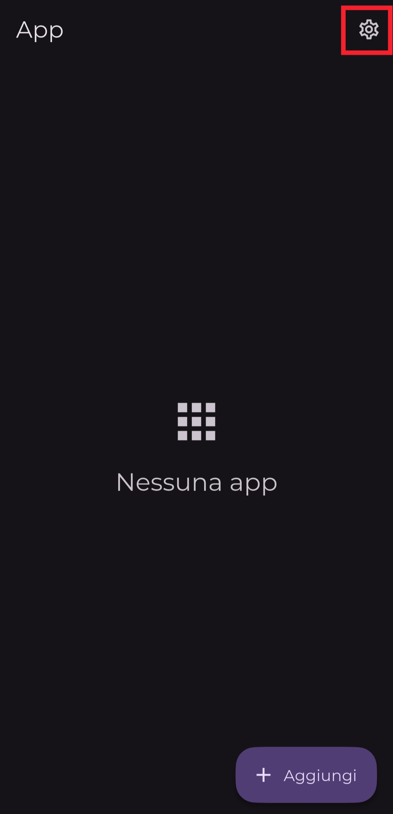
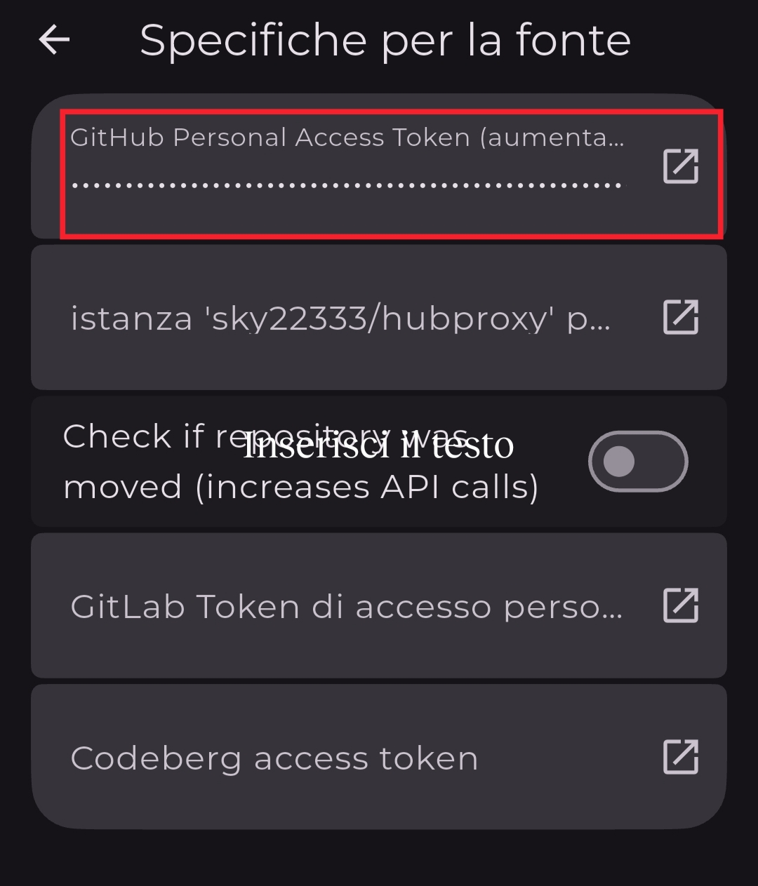

# Installazione e configurazione iniziale

1. Scarica e installa Obtainium aprendo il file scaricato

2. Aprire Obtanium e andare nelle Impostazioni
3. Cliccare su "Specifiche per la fonte"
4. Incollare il numero univoco che ti ho inviato sul campo "GitHub Personal Access Token"

Immagini di esempio

        

# Aggiunta delle app

Cliccare su ognuno dei seguenti pulsanti per aggiungere le app di cui si vuole ricevere gli aggiornamenti.
NB: MicroG-RE è obbligatorio.

### MicroG-RE (Obbligatorio)
Clicca obbligatoriamente sul pulsante per ottenere MicroG-RE, requisito fondamentale per il funzionamento di YouTube e YouTube Music.

[](%7B%0A%20%20%20%20%22schemaVersion%22%3A%202%2C%0A%20%20%20%20%22exportedAt%22%3A%20%222026-11-19T12%3A41%3A12.003661%22%2C%0A%20%20%20%20%22appVersion%22%3A%20%220.0.0%22%2C%0A%20%20%20%20%22apps%22%3A%20%5B%0A%20%20%20%20%20%20%20%20%7B%0A%20%20%20%20%20%20%20%20%20%20%20%20%22id%22%3A%20%22app.morphe.android.youtube%22%2C%0A%20%20%20%20%20%20%20%20%20%20%20%20%22url%22%3A%20%22https%3A%2F%2Fgithub.com%2Frichiemeggio%2Fmorphe%22%2C%0A%20%20%20%20%20%20%20%20%20%20%20%20%22author%22%3A%20%22richiemeggio%22%2C%0A%20%20%20%20%20%20%20%20%20%20%20%20%22name%22%3A%20%22YouTube%22%2C%0A%20%20%20%20%20%20%20%20%20%20%20%20%22installedVersion%22%3A%20%2221.30.216%22%2C%0A%20%20%20%20%20%20%20%20%20%20%20%20%22latestVersion%22%3A%20%22Sconosciuto%22%2C%0A%20%20%20%20%20%20%20%20%20%20%20%20%22apkUrls%22%3A%20%22%5B%5B%5C%22placeholder%5C%22%2C%5C%22placeholder%5C%22%5D%5D%22%2C%0A%20%20%20%20%20%20%20%20%20%20%20%20%22otherAssetUrls%22%3A%20%22%5B%5D%22%2C%0A%20%20%20%20%20%20%20%20%20%20%20%20%22preferredApkIndex%22%3A%200%2C%0A%20%20%20%20%20%20%20%20%20%20%20%20%22additionalSettings%22%3A%20%22%7B%5C%22includePrereleases%5C%22%3Afalse%2C%5C%22includeDrafts%5C%22%3Afalse%2C%5C%22fallbackToOlderReleases%5C%22%3Atrue%2C%5C%22filterReleaseTitlesByRegEx%5C%22%3A%5C%22%5C%22%2C%5C%22invertReleaseTitlesFilter%5C%22%3Afalse%2C%5C%22filterReleaseNotesByRegEx%5C%22%3A%5C%22%5C%22%2C%5C%22invertReleaseNotesFilter%5C%22%3Afalse%2C%5C%22verifyLatestTag%5C%22%3Afalse%2C%5C%22sortMethodChoice%5C%22%3A%5C%22date%5C%22%2C%5C%22useLatestAssetDateAsReleaseDate%5C%22%3Afalse%2C%5C%22releaseTitleAsVersion%5C%22%3Afalse%2C%5C%22versionExtractionRegEx%5C%22%3A%5C%22%5C%22%2C%5C%22matchGroupToUse%5C%22%3A%5C%22%5C%22%2C%5C%22versionDetection%5C%22%3Afalse%2C%5C%22releaseDateAsVersion%5C%22%3Atrue%2C%5C%22useVersionCodeAsOSVersion%5C%22%3Afalse%2C%5C%22apkFilterRegEx%5C%22%3A%5C%22%5Eyt.%2A%5C%5C%5C%5C.apk%24%5C%22%2C%5C%22invertAPKFilter%5C%22%3Afalse%2C%5C%22autoApkFilterByArch%5C%22%3Atrue%2C%5C%22includeZips%5C%22%3Afalse%2C%5C%22zippedApkFilterRegEx%5C%22%3A%5C%22%5C%22%2C%5C%22includeTarballs%5C%22%3Afalse%2C%5C%22tarballedApkFilterRegEx%5C%22%3A%5C%22%5C%22%2C%5C%22minimumUpdateAgeDays%5C%22%3A%5C%22%5C%22%2C%5C%22exemptFromBackgroundUpdates%5C%22%3Afalse%2C%5C%22skipUpdateNotifications%5C%22%3Afalse%2C%5C%22refreshBeforeDownload%5C%22%3Afalse%2C%5C%22detectionDateAsReleaseDate%5C%22%3Afalse%2C%5C%22trackOnly%5C%22%3Afalse%2C%5C%22appName%5C%22%3A%5C%22%5C%22%2C%5C%22appAuthor%5C%22%3A%5C%22%5C%22%2C%5C%22installerMode%5C%22%3A%5C%22%5C%22%2C%5C%22shizukuPretendToBeGooglePlay%5C%22%3Afalse%2C%5C%22allowInsecure%5C%22%3Afalse%2C%5C%22allowedSigningCertHashes%5C%22%3A%5C%22%5C%22%2C%5C%22about%5C%22%3A%5C%22%5C%22%2C%5C%22updateHealthStaleRelease%5C%22%3A%5C%22%5C%22%2C%5C%22updateHealthStaleVersion%5C%22%3A%5C%22%5C%22%2C%5C%22updateHealthFailedChecks%5C%22%3A%5C%22%5C%22%2C%5C%22updateHealthArchived%5C%22%3A%5C%22%5C%22%2C%5C%22updateHealthFilteredReleases%5C%22%3A%5C%22%5C%22%7D%22%2C%0A%20%20%20%20%20%20%20%20%20%20%20%20%22lastUpdateCheck%22%3A%20null%2C%0A%20%20%20%20%20%20%20%20%20%20%20%20%22pinned%22%3A%20false%2C%0A%20%20%20%20%20%20%20%20%20%20%20%20%22disabled%22%3A%20false%2C%0A%20%20%20%20%20%20%20%20%20%20%20%20%22categories%22%3A%20%5B%5D%2C%0A%20%20%20%20%20%20%20%20%20%20%20%20%22releaseDate%22%3A%20null%2C%0A%20%20%20%20%20%20%20%20%20%20%20%20%22changeLog%22%3A%20null%2C%0A%20%20%20%20%20%20%20%20%20%20%20%20%22releaseUrl%22%3A%20null%2C%0A%20%20%20%20%20%20%20%20%20%20%20%20%22overrideSource%22%3A%20null%2C%0A%20%20%20%20%20%20%20%20%20%20%20%20%22allowIdChange%22%3A%20false%2C%0A%20%20%20%20%20%20%20%20%20%20%20%20%22pendingRepoRenameUrl%22%3A%20null%2C%0A%20%20%20%20%20%20%20%20%20%20%20%20%22apkSizeBytes%22%3A%20null%2C%0A%20%20%20%20%20%20%20%20%20%20%20%20%22latestVersionChangedAt%22%3A%20null%2C%0A%20%20%20%20%20%20%20%20%20%20%20%20%22consecutiveFailedChecks%22%3A%200%2C%0A%20%20%20%20%20%20%20%20%20%20%20%20%22isArchived%22%3A%20null%2C%0A%20%20%20%20%20%20%20%20%20%20%20%20%22newerReleasesFilteredOut%22%3A%20null%2C%0A%20%20%20%20%20%20%20%20%20%20%20%20%22updateHealthEnabled%22%3A%20true%2C%0A%20%20%20%20%20%20%20%20%20%20%20%20%22updateHealthDismissedVersion%22%3A%20null%0A%20%20%20%20%20%20%20%20%7D%2C%0A%20%20%20%20%20%20%20%20%7B%0A%20%20%20%20%20%20%20%20%20%20%20%20%22id%22%3A%20%22app.morphe.android.apps.youtube.music%22%2C%0A%20%20%20%20%20%20%20%20%20%20%20%20%22url%22%3A%20%22https%3A%2F%2Fgithub.com%2Frichiemeggio%2Fmorphe%22%2C%0A%20%20%20%20%20%20%20%20%20%20%20%20%22author%22%3A%20%22richiemeggio%22%2C%0A%20%20%20%20%20%20%20%20%20%20%20%20%22name%22%3A%20%22YT%20Music%22%2C%0A%20%20%20%20%20%20%20%20%20%20%20%20%22installedVersion%22%3A%20%229.30.53%22%2C%0A%20%20%20%20%20%20%20%20%20%20%20%20%22latestVersion%22%3A%20%22Sconosciuto%22%2C%0A%20%20%20%20%20%20%20%20%20%20%20%20%22apkUrls%22%3A%20%22%5B%5B%5C%22placeholder%5C%22%2C%5C%22placeholder%5C%22%5D%5D%22%2C%0A%20%20%20%20%20%20%20%20%20%20%20%20%22otherAssetUrls%22%3A%20%22%5B%5D%22%2C%0A%20%20%20%20%20%20%20%20%20%20%20%20%22preferredApkIndex%22%3A%200%2C%0A%20%20%20%20%20%20%20%20%20%20%20%20%22additionalSettings%22%3A%20%22%7B%5C%22includePrereleases%5C%22%3Afalse%2C%5C%22includeDrafts%5C%22%3Afalse%2C%5C%22fallbackToOlderReleases%5C%22%3Atrue%2C%5C%22filterReleaseTitlesByRegEx%5C%22%3A%5C%22%5C%22%2C%5C%22invertReleaseTitlesFilter%5C%22%3Afalse%2C%5C%22filterReleaseNotesByRegEx%5C%22%3A%5C%22%5C%22%2C%5C%22invertReleaseNotesFilter%5C%22%3Afalse%2C%5C%22verifyLatestTag%5C%22%3Afalse%2C%5C%22sortMethodChoice%5C%22%3A%5C%22date%5C%22%2C%5C%22useLatestAssetDateAsReleaseDate%5C%22%3Afalse%2C%5C%22releaseTitleAsVersion%5C%22%3Afalse%2C%5C%22versionExtractionRegEx%5C%22%3A%5C%22%5C%22%2C%5C%22matchGroupToUse%5C%22%3A%5C%22%5C%22%2C%5C%22versionDetection%5C%22%3Afalse%2C%5C%22releaseDateAsVersion%5C%22%3Atrue%2C%5C%22useVersionCodeAsOSVersion%5C%22%3Afalse%2C%5C%22apkFilterRegEx%5C%22%3A%5C%22%5Emusic.%2A%5C%5C%5C%5C.apk%24%5C%22%2C%5C%22invertAPKFilter%5C%22%3Afalse%2C%5C%22autoApkFilterByArch%5C%22%3Atrue%2C%5C%22includeZips%5C%22%3Afalse%2C%5C%22zippedApkFilterRegEx%5C%22%3A%5C%22%5C%22%2C%5C%22includeTarballs%5C%22%3Afalse%2C%5C%22tarballedApkFilterRegEx%5C%22%3A%5C%22%5C%22%2C%5C%22minimumUpdateAgeDays%5C%22%3A%5C%22%5C%22%2C%5C%22exemptFromBackgroundUpdates%5C%22%3Afalse%2C%5C%22skipUpdateNotifications%5C%22%3Afalse%2C%5C%22refreshBeforeDownload%5C%22%3Afalse%2C%5C%22detectionDateAsReleaseDate%5C%22%3Afalse%2C%5C%22trackOnly%5C%22%3Afalse%2C%5C%22appName%5C%22%3A%5C%22%5C%22%2C%5C%22appAuthor%5C%22%3A%5C%22%5C%22%2C%5C%22installerMode%5C%22%3A%5C%22%5C%22%2C%5C%22shizukuPretendToBeGooglePlay%5C%22%3Afalse%2C%5C%22allowInsecure%5C%22%3Afalse%2C%5C%22allowedSigningCertHashes%5C%22%3A%5C%22%5C%22%2C%5C%22about%5C%22%3A%5C%22%5C%22%2C%5C%22updateHealthStaleRelease%5C%22%3A%5C%22%5C%22%2C%5C%22updateHealthStaleVersion%5C%22%3A%5C%22%5C%22%2C%5C%22updateHealthFailedChecks%5C%22%3A%5C%22%5C%22%2C%5C%22updateHealthArchived%5C%22%3A%5C%22%5C%22%2C%5C%22updateHealthFilteredReleases%5C%22%3A%5C%22%5C%22%7D%22%2C%0A%20%20%20%20%20%20%20%20%20%20%20%20%22lastUpdateCheck%22%3A%20null%2C%0A%20%20%20%20%20%20%20%20%20%20%20%20%22pinned%22%3A%20false%2C%0A%20%20%20%20%20%20%20%20%20%20%20%20%22disabled%22%3A%20false%2C%0A%20%20%20%20%20%20%20%20%20%20%20%20%22categories%22%3A%20%5B%5D%2C%0A%20%20%20%20%20%20%20%20%20%20%20%20%22releaseDate%22%3A%20null%2C%0A%20%20%20%20%20%20%20%20%20%20%20%20%22changeLog%22%3A%20null%2C%0A%20%20%20%20%20%20%20%20%20%20%20%20%22releaseUrl%22%3A%20null%2C%0A%20%20%20%20%20%20%20%20%20%20%20%20%22overrideSource%22%3A%20null%2C%0A%20%20%20%20%20%20%20%20%20%20%20%20%22allowIdChange%22%3A%20false%2C%0A%20%20%20%20%20%20%20%20%20%20%20%20%22pendingRepoRenameUrl%22%3A%20null%2C%0A%20%20%20%20%20%20%20%20%20%20%20%20%22apkSizeBytes%22%3A%20null%2C%0A%20%20%20%20%20%20%20%20%20%20%20%20%22latestVersionChangedAt%22%3A%20null%2C%0A%20%20%20%20%20%20%20%20%20%20%20%20%22consecutiveFailedChecks%22%3A%200%2C%0A%20%20%20%20%20%20%20%20%20%20%20%20%22isArchived%22%3A%20null%2C%0A%20%20%20%20%20%20%20%20%20%20%20%20%22newerReleasesFilteredOut%22%3A%20null%2C%0A%20%20%20%20%20%20%20%20%20%20%20%20%22updateHealthEnabled%22%3A%20true%2C%0A%20%20%20%20%20%20%20%20%20%20%20%20%22updateHealthDismissedVersion%22%3A%20null%0A%20%20%20%20%20%20%20%20%7D%0A%20%20%20%20%5D%2C%0A%20%20%20%20%22settings%22%3A%20null%0A%7D)

[](https://apps.obtainium.imranr.dev/redirect?r=obtainium://app/%7B%0A%20%20%20%20%22id%22%3A%20%22app.revanced.android.gms%22%2C%0A%20%20%20%20%22url%22%3A%20%22https%3A%2F%2Fgithub.com%2FMorpheApp%2FMicroG-RE%22%2C%0A%20%20%20%20%22author%22%3A%20%22MorpheApp%22%2C%0A%20%20%20%20%22name%22%3A%20%22MicroG%20RE%22%2C%0A%20%20%20%20%22additionalSettings%22%3A%20%22%7B%5C%22includePrereleases%5C%22%3Afalse%2C%5C%22includeDrafts%5C%22%3Afalse%2C%5C%22fallbackToOlderReleases%5C%22%3Atrue%2C%5C%22sortMethodChoice%5C%22%3A%5C%22date%5C%22%2C%5C%22versionDetection%5C%22%3Atrue%2C%5C%22apkFilterRegEx%5C%22%3A%5C%22%5Emicrog-%5C%5C%5C%5Cd%2B%5C%5C%5C%5C.%5C%5C%5C%5Cd%2B%5C%5C%5C%5C.%5C%5C%5C%5Cd%2B-icon-arm64-v8a%5C%5C%5C%5C.apk%24%5C%22%2C%5C%22autoApkFilterByArch%5C%22%3Atrue%7D%22%0A%7D)

### Youtube Music
Clicca sul pulsante per ottenere YouTube Music

[](https://apps.obtainium.imranr.dev/redirect?r=obtainium://app/%7B%0A%20%20%20%20%22id%22%3A%20%22app.morphe.android.apps.youtube.music%22%2C%0A%20%20%20%20%22url%22%3A%20%22https%3A%2F%2Fgithub.com%2Frichiemeggio%2Fmorphe%22%2C%0A%20%20%20%20%22author%22%3A%20%22richiemeggio%22%2C%0A%20%20%20%20%22name%22%3A%20%22YT%20Music%22%2C%0A%20%20%20%20%22additionalSettings%22%3A%20%22%7B%5C%22includePrereleases%5C%22%3Afalse%2C%5C%22includeDrafts%5C%22%3Afalse%2C%5C%22fallbackToOlderReleases%5C%22%3Atrue%2C%5C%22sortMethodChoice%5C%22%3A%5C%22date%5C%22%2C%5C%22releaseDateAsVersion%5C%22%3Atrue%2C%5C%22apkFilterRegEx%5C%22%3A%5C%22%5Emusic.%2A%5C%5C%5C%5C.apk%24%5C%22%2C%5C%22autoApkFilterByArch%5C%22%3Atrue%7D%22%0A%7D)

### YouTube
Clicca sul pulsante per ottenere YouTube

[](https://apps.obtainium.imranr.dev/redirect?r=obtainium://app/%7B%0A%20%20%20%20%22id%22%3A%20%22app.morphe.android.youtube%22%2C%0A%20%20%20%20%22url%22%3A%20%22https%3A%2F%2Fgithub.com%2Frichiemeggio%2Fmorphe%22%2C%0A%20%20%20%20%22author%22%3A%20%22richiemeggio%22%2C%0A%20%20%20%20%22name%22%3A%20%22YouTube%22%2C%0A%20%20%20%20%22additionalSettings%22%3A%20%22%7B%5C%22includePrereleases%5C%22%3Afalse%2C%5C%22includeDrafts%5C%22%3Afalse%2C%5C%22fallbackToOlderReleases%5C%22%3Atrue%2C%5C%22sortMethodChoice%5C%22%3A%5C%22date%5C%22%2C%5C%22releaseDateAsVersion%5C%22%3Atrue%2C%5C%22apkFilterRegEx%5C%22%3A%5C%22%5Eyt.%2A%5C%5C%5C%5C.apk%24%5C%22%2C%5C%22autoApkFilterByArch%5C%22%3Atrue%7D%22%0A%7D)

### Instragram
Clicca sul pulsante per ottenere Instagram Plus

[](https://apps.obtainium.imranr.dev/redirect?r=obtainium://app/%7B%0A%20%20%20%20%22id%22%3A%20%22com.instagram.android%22%2C%0A%20%20%20%20%22url%22%3A%20%22https%3A%2F%2Fgithub.com%2Frichiemeggio%2Fmorphe%22%2C%0A%20%20%20%20%22author%22%3A%20%22richiemeggio%22%2C%0A%20%20%20%20%22name%22%3A%20%22Instagram%22%2C%0A%20%20%20%20%22additionalSettings%22%3A%20%22%7B%5C%22includePrereleases%5C%22%3Afalse%2C%5C%22includeDrafts%5C%22%3Afalse%2C%5C%22fallbackToOlderReleases%5C%22%3Atrue%2C%5C%22sortMethodChoice%5C%22%3A%5C%22date%5C%22%2C%5C%22releaseDateAsVersion%5C%22%3Atrue%2C%5C%22apkFilterRegEx%5C%22%3A%5C%22%5Eig.%2A%5C%5C%5C%5C.apk%24%5C%22%2C%5C%22autoApkFilterByArch%5C%22%3Atrue%7D%22%0A%7D)

---

### D'ora in poi si riceveranno gli aggiornamenti per le app scelte tramite Obtainium